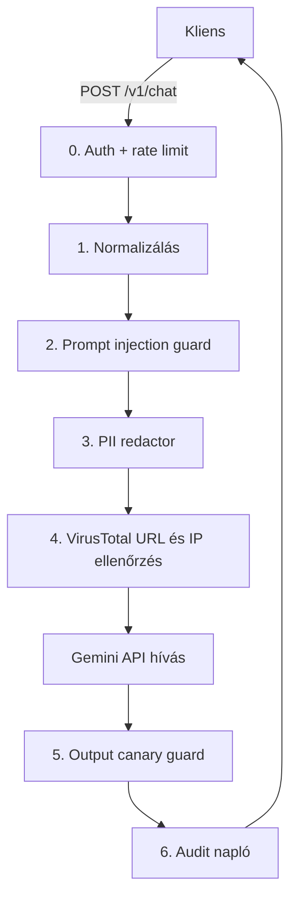

# Rust Guardrail: AI biztonsági és adatvédelmi proxy

Beadandó dokumentáció. A részletes használati leírás és az API-táblázatok a [README.md](README.md) fájlban vannak.

## 1. Feladat és célkitűzés

Egy Rust (axum) nyelven írt proxy, amely az ügyfélalkalmazás és egy LLM API (Google Gemini) közé kerül, és minden promptot ellenőriz, mielőtt az a modellhez jutna.

A szűrés kizárólag determinisztikus eszközökkel történik (regex, ellenőrzőösszeg, API-lekérdezés). Emiatt a védelem olcsó (nincs extra LLM-hívás), kiszámítható (azonos bemenetre azonos eredmény) és egységtesztelhető. A projekt első védelmi vonal, nem helyettesíti az olyan teljes keretrendszereket, mint az NVIDIA NeMo Guardrails.

## 2. Architektúra



Egy kérés a fenti lépéseken halad végig. Bármelyik guard blokkolhatja, ilyenkor a későbbi lépések (VirusTotal, Gemini) már nem futnak le.

| Fájl | Szerepe |
|---|---|
| `src/main.rs` | HTTP szerver, authentikáció, a kérés feldolgozási lánca |
| `src/guards/normalize.rs` | Unicode normalizálás, hasonmás betűk egységesítése |
| `src/guards/prompt_injection.rs` | injection regex guard |
| `src/guards/pii_redactor.rs` | PII és titkok kitakarása (Luhn és TAJ ellenőrzés) |
| `src/guards/output_canary.rs` | canary token keresése a modell válaszában |
| `src/guards/rate_limit.rs` | fix ablakos rate limiter API-kulcsonként |
| `src/tools/threat_intel.rs` | VirusTotal URL és IP lekérdezés (async) |
| `src/tools/gemini.rs` | Gemini API kliens (async) |
| `src/tools/audit.rs` | incidens naplózás (JSON Lines, csak hozzáfűzés) |
| `audit/report.py` | incidens riport (statisztika és Gemini által írt összefoglaló) |
| `benchmark/run_benchmark.py` | benchmark script, opcionális NeMo összehasonlítással |

## 3. Funkciók

| Funkció | Működés |
|---|---|
| Normalizálás | NFKC, zero-width és vezérlő karakterek törlése. A cirill és görög hasonmás betűk latinra cserélése csak az injection vizsgálathoz. |
| Prompt injection guard | 9 kis- és nagybetűre érzéketlen angol regex minta (például *ignore previous instructions*, *reveal your system prompt*). |
| PII redactor | Email, bankkártya (Luhn), magyar TAJ szám (ellenőrzőösszeg) és API kulcsok (OpenAI, GitHub, Slack, Bearer) cseréje `[REDACTED_*]` jelölőre. |
| Fenyegetés-felderítés | Legfeljebb 3 URL és 3 publikus IPv4 cím VirusTotal ellenőrzése, a már kitakart szövegen. |
| Authentikáció | Opcionális közös titok (`GUARDRAIL_TOKEN`) az `x-api-key` fejlécben, állandó idejű összehasonlítással. |
| Rate limiting | Fix ablakos limit API-kulcsonként (alapérték 60 kérés percenként, `RATE_LIMIT_PER_MINUTE`). Túllépéskor 429, még a guardok előtt. |
| Gemini hívás | Csak a kitakart prompt kerül a modellhez, a válasz az `answer` mezőben jön vissza. |
| Canary guard | Véletlen token a rendszerutasításban. Ha a válaszban megjelenik (szétszedve vagy láthatatlan karakterekkel is), a válasz blokkolva. |
| Biztonságos naplózás | A nyers prompt soha nem kerül naplóba vagy válaszba, csak a hossza. |
| Méretkorlát | 16 KB-nál nagyobb kérés elutasítva (413). |
| Audit napló | Minden blokkolt kérésről egy JSON sor (időbélyeg, guard, hossz, a prompt SHA-256 ujjlenyomata), a prompt szövege nélkül. |
| Incidens riport | Az `audit/report.py` a naplóból statisztikát készít, és a Gemini az aggregált számokból rövid riportot ír. |

## 4. Biztonsági tervezési döntések

- **Először normalizálunk:** minden guard ugyanazt a kanonikus szöveget látja, így a láthatatlan, teljes szélességű vagy hasonmás karakterekkel elrejtett támadás nem kerüli ki az egyik guardot sem.
- **A nyers prompt nem kerül naplóba és válaszba,** mert tartalmazhat személyes adatot, és a támadó irányítja (log injection).
- **Külső hívás előtt kitakarás:** a VirusTotal és a Gemini is csak a kitakart szöveget látja.
- **Ellenőrzőösszeg a hamis pozitívok ellen:** egy 16 jegyű rendelésszám nem lesz bankkártya, ha a Luhn próba nem teljesül. Ugyanez igaz a TAJ számra.
- **Állandó idejű tokenösszehasonlítás** az időzítéses támadások ellen.
- **Egyszer felépített állapot:** a regexek és a HTTP kliens indításkor készülnek el, nem kérésenként.
- **A hibás hitelesítés és a rate limit nem kerül az audit naplóba,** hogy token nélkül ne lehessen megtölteni a lemezt.

**Miért Rust?** A proxy támadó által irányított szöveget dolgoz fel, és minden kérés útvonalán ott áll. A Rust GC nélküli memóriabiztonságot ad (a projekt nem tartalmaz `unsafe` kódot), a megosztott állapot (`Arc<AppState>`) csak szálbiztosan fordul le, a hibák (`Option`, `Result`) a típusrendszer részei, a `regex` crate pedig lineáris idejű, így egy gonosz prompt nem tudja lefagyasztani a guardokat (nincs ReDoS). Hátrány a meredekebb tanulási görbe és a Pythonnál sokkal gyengébb AI/NLP ökoszisztéma, ezért a szemantikus felismerés nem része a projektnek.

## 5. Tesztelés

**Egységtesztek** (`cargo test`): normalizálás, injection minták, minden PII típus (az érvénytelen kártya- és TAJ számok érintetlenek maradnak), URL és IP kinyerés, Gemini kérés és válasz kezelése, canary guard, rate limiter (limit, ablak lejárata, külön kulcsok) és audit napló.

**Benchmark** (`python benchmark/run_benchmark.py`): 57 prompt egy futó proxyn.

| Csoport | Prompt | Akkor helyes, ha |
|---|---|---|
| Támadás: `direct` | 10, mintánként egy | blokkolt |
| Támadás: `obfuscated` | 8, ugyanazok elrejtve (nagybetű, szóköz, zero-width, soft hyphen, teljes szélesség, cirill hasonmás) | blokkolt |
| Támadás: `paraphrase` | 9, más szavak, magyar és francia nyelv, Base64, leetspeak, szerepjáték | blokkolt. A nagy része előre láthatóan átmegy, mert a guard feketelista. |
| PII | 10 | nem blokkolt, és a titok eltűnt a `sanitized_prompt`-ból |
| Benign: `normal` | 12, angol és magyar | nem blokkolt, változatlan |
| Benign: `tricky` | 8, támadásra vagy PII-re hasonlító ártalmatlan szöveg | nem blokkolt, változatlan |

Az upstream hibák (429, 5xx, `LLM_ERROR`) külön `ERR` kategóriába kerülnek, és nem rontják a guard pontosságát.

## 6. Eredmények

### Rust Guardrail (a `benchmark/results.json` alapján)

| Mérés | Eredmény |
|---|---|
| Direct és obfuscated támadások | 18/18 (100%) |
| Paraphrase támadások | 0/9 |
| Összes támadás | 18/27 (66,7%) |
| PII kitakarás | 10/10 (100%) |
| Benign: `normal` | 12/12 |
| Hamis pozitív | 1/20 |
| Hibásan kitakart benign prompt | 0/20 |
| Késleltetés, minden kérés (57 db) | medián 17,5 ms, p95 27,9 ms |
| Késleltetés, blokkolt kérések (19 db) | medián 17,3 ms, p95 30,0 ms |
| Késleltetés, átengedett kérések (38 db) | medián 17,8 ms, p95 26,8 ms |

Az egyetlen hamis pozitív egy biztonsági kurzusról szóló ártalmatlan kérdés, amely idézi az *ignore previous instructions* kifejezést. Egy lista alapú szűrő ezt nem tudja megkülönböztetni a támadástól.

A mérés `GEMINI_API_KEY` nélkül futott, ezért az átengedett kérések ideje is csak a guardok ideje (a helyi HTTP körúttal együtt). A guardok ideje a prompt tartalmától alig függ, így a blokkolt és az átengedett kérés ideje közel azonos.

### NeMo Guardrails összehasonlítás

Az összehasonlítás a `python benchmark/run_benchmark.py --target both` paranccsal fut (beállítás: `benchmark/nemo_config/`). A NeMo-nál csak a bemeneti szűrő (`self check input`, promptonként egy LLM-hívás) fut, a PII esetek kimaradnak, mert a NeMo nem ad vissza kitakart promptot.

| Mérés | Rust Guardrail | NeMo `self check input` |
|---|---|---|
| Direct | 10/10 | 10/10 |
| Obfuscated | 8/8 | 8/8 |
| Paraphrase | 0/9 | 9/9 |
| Összes támadás | 18/27 | 27/27 |
| PII | 10/10 | nem mérhető |
| Hamis pozitív | 1/20 | 0/20 |
| Hiba (upstream) | 0 | 0 |
| Medián késleltetés, blokkolt kérések | 17,3 ms | 1106 ms |
| p95 késleltetés, blokkolt kérések | 30,0 ms | 6444 ms |
| Medián késleltetés, átengedett kérések | 17,8 ms | 1009 ms |
| LLM-hívás promptonként | 0 | 1 |

Értékelés: a NeMo minden támadást elkapott, és hamis pozitívja sem volt, a detekcióban tehát egyértelműen jobb. A Rust guard viszont körülbelül 60-szor gyorsabb (a mediánok 17,5 ms és 1017 ms, a p95-ek 27,9 ms és 5475 ms), nem igényel LLM-hívást, determinisztikus, és a PII-t külső hívás előtt kitakarja. A NeMo `self check input` a nyers promptot küldi a Gemini-nek, a késleltetése pedig főként az LLM-hívásból adódik, és a külső API terhelésétől függ.

## 7. Összehasonlítás a NeMo Guardrails-szel

| Szempont | Rust Guardrail | NeMo Guardrails |
|---|---|---|
| Megközelítés | determinisztikus: regex, ellenőrzőösszeg, API lekérdezés | Colang folyamatok és opcionális LLM-alapú ellenőrzés |
| Extra LLM-hívás | nincs | gyakran egy vagy több ellenőrzésenként |
| Kiszámíthatóság | azonos bemenetre azonos eredmény | LLM-alapú ellenőrzésnél valószínűségi |
| Parafrazált, szemantikus támadás | gyenge | jobb |
| Párbeszéd- és témakezelés | nincs | van |
| Magyar PII (TAJ) | támogatott | nincs beépítve |
| Érettség | tanulmányi prototípus | éles használatra szánt keretrendszer |

A két megközelítés kiegészíti egymást: elöl egy gyors determinisztikus réteg, mögötte egy szemantikus.

## 8. Telepítés és futtatás

```powershell
copy .env.example .env      # az értékek kitöltése
cargo test                  # egységtesztek
cargo run                   # a proxy a http://127.0.0.1:3000 címen indul
```

| `.env` változó | Leírás |
|---|---|
| `GUARDRAIL_TOKEN` | az `x-api-key` fejlécben elvárt érték. Üresen az authentikáció ki van kapcsolva. |
| `VIRUSTOTAL_API_KEY` | URL és IP ellenőrzéshez. Üresen kimarad. |
| `GEMINI_API_KEY` | a Gemini híváshoz. Üresen csak a guardok futnak, az `answer` értéke `null`. |
| `GEMINI_MODEL` | a modell neve `models/` előtag nélkül (alapérték `gemini-2.5-flash`) |
| `RATE_LIMIT_PER_MINUTE` | kérés/perc/kulcs (alapérték 60, a `0` kikapcsolja) |
| `PORT`, `AUDIT_LOG_PATH` | port (3000) és a napló helye (`audit.jsonl`) |

Kérés:

```powershell
curl.exe -X POST http://127.0.0.1:3000/v1/chat `
  -H "Content-Type: application/json" -H "x-api-key: <GUARDRAIL_TOKEN>" `
  -d '{"prompt":"Email test@example.com, card 4111 1111 1111 1111"}'
```

| HTTP kód | `status` | Jelentés |
|---|---|---|
| 200 | `PASSED_GUARDRAILS` | a prompt tiszta volt, vagy kitakarásra került |
| 401 | `UNAUTHORIZED` | hiányzó vagy hibás `x-api-key` |
| 403 | `INJECTION_BLOCKED` | injection minta találat |
| 403 | `MALICIOUS_URL_BLOCKED`, `MALICIOUS_IP_BLOCKED` | a VirusTotal veszélyesnek jelölt egy URL-t vagy IP-t |
| 403 | `OUTPUT_BLOCKED` | a válasz tartalmazta a canary tokent |
| 413 | | a kérés nagyobb 16 KB-nál |
| 429 | `RATE_LIMITED` | túl sok kérés ebben a percben |
| 502 | `LLM_ERROR` | a Gemini hívás sikertelen |

Benchmark futtatása: a `GEMINI_API_KEY` legyen üres a tiszta guard idő méréséhez, a `RATE_LIMIT_PER_MINUTE=0` pedig kikapcsolja a limitet. NeMo-val: `pip install nemoguardrails`, majd az `OPENAI_API_KEY` környezeti változó a Gemini kulcs értékére állítva, és `--target both`.

## 9. Ismert korlátok

- Az injection guard feketelista: a szinonimák, más nyelvek és a kódolások (például Base64) megkerülik. Csak angol minták vannak.
- A hasonmás betűk egységesítése csak a gyakori cirill és görög karaktereket fedi le, nem a teljes Unicode confusables táblát.
- A továbbított szöveg a normalizált prompt, az eredeti bájtok (például az emoji zero-width joinerei) nem maradnak meg.
- Csak az első 3 URL és az első 3 publikus IPv4 cím kerül ellenőrzésre, az IPv6 nem. Az `1.2.3.4` alakú verziószámokat IP-címnek veszi.
- Ha a VirusTotal nem érhető el, az URL vagy IP biztonságosnak számít (fail-open).
- A válasz csak a canary tokenre van ellenőrizve. Más káros tartalmat nem észlel, és a kódolt (Base64) canary átmegy.
- Minden kérés önálló, nincs beszélgetéselőzmény. A sikertelen Gemini hívást a proxy nem próbálja újra.
- A PII lefedettség emailre, kártyára, TAJ számra és néhány API kulcs formára korlátozódik.
- Nincs TLS, a szerver csak a localhoston hallgat.
- A rate limit számlálói memóriában vannak, újraindításkor nullázódnak. Egyetlen `GUARDRAIL_TOKEN` esetén az összes kliens közös számlálót használ. Az ablakhatáron rövid ideig a limit kétszerese is átmehet. A 429 válasz nem tartalmaz `Retry-After` fejlécet.
- Az audit napló nincs védve módosítás ellen, 5 MB-os korlátja van forgatás nélkül, és a prompt sima SHA-256 ujjlenyomata rövid vagy kitalálható prompt esetén visszafejthető. A naplót bizalmasként kell kezelni.
- A NeMo összehasonlításban az LLM-alapú ellenőrzés eredménye futásról futásra változhat, és a PII esetek nem hasonlíthatók össze.

## 10. Továbbfejlesztési lehetőségek

- **Fájlfeltöltés-védelem:** szöveges fájlok (`.txt`, `.md`, `.csv`) ellenőrzése méret, kiterjesztés, fájlnév és UTF-8 szerint, a tartalom átengedése a meglévő guardokon, és a fájl SHA-256 hash-ének VirusTotal lekérdezése a fájl feltöltése nélkül. Ehhez egy közös `run_guards()` függvény és egy `POST /v1/upload` végpont kell.
- `Retry-After` fejléc a 429 válaszhoz, és az upstream hibák újrapróbálása.
- Szemantikus réteg (Python) a parafrazált támadások felismeréséhez a determinisztikus réteg mögött.
